# Cloakroom

A local gateway that lets a cloud AI assistant work with your personal files and apps while keeping detected private details on your laptop.

Built for wHACKiest 2026 under Track 1: Make MCP Matter (Less Magic, More Utility).

## Problem

Some of the most useful things an AI assistant can do involve a person's most sensitive records. Checking a hospital bill against a bank statement, comparing the difference with an insurance policy and drafting a dispute email touches names, account numbers, medical identifiers and money in a single task.

The Model Context Protocol (MCP) lets an assistant read local files and use apps, which makes that task possible. The default setup brings three problems with it.

- **Leak.** Every tool result goes to a cloud model and to whatever logging surrounds it. A bill read through MCP arrives with the patient's name, record number and bank account intact.
- **Uncontrolled action.** The connection that reads can also send, share or delete, usually under one blanket permission. Text the assistant reads, such as a PDF or an email, can try to steer what it does next.
- **Overload.** Each connected server adds tool definitions to every request. With enough servers the model carries hundreds of them, which costs tokens and makes a wrong tool choice more likely.

So people either skip the connection and do the paperwork by hand, or connect everything and hope.

## Solution

Cloakroom is a gateway process that runs on the user's machine. The assistant's host application (Claude Desktop, for example) connects to it as if it were one MCP server. Cloakroom in turn connects to the user's real MCP servers. Tool traffic for the connected servers passes through Cloakroom.

The design rests on one rule: the assistant does the thinking, and deterministic code guards the doors. Whether a value is private, whether it may be restored and whether an action needs approval are decided by rules that can be read, tested and audited. No language model takes part in those decisions.

The name describes the mechanism. You leave your coat (your identity) at the door, the assistant receives a numbered ticket such as `[PERSON_1]`, and the coat is handed back only to places you have allowed.

## Key features

| Goal | Meaning | Main mechanisms |
| --- | --- | --- |
| Private details stay local | Detected private values are replaced before reaching the cloud model | Gazetteer, detectors, vault, tripwire |
| Approval for external actions | Actions that send, share, delete or are unrecognised wait for the user | Effect classes, out-of-band approval |
| Tools are discovered on demand | Tools are found on demand instead of listed up front | Three meta-tools, hybrid retrieval |

### Privacy tiers

| Tier | Examples | Default |
| --- | --- | --- |
| Identifiers | Government IDs, card and account numbers, phone, email, medical record numbers, credentials | Always masked |
| Contextual | Person names, addresses, employer, organisations known to the gazetteer | Masked |
| Analytical | Amounts, dates, quantities | Visible, so the assistant can do arithmetic |

Each tier can be switched in the Control Room or in configuration. Organisation names are masked only when the gazetteer knows them, because name-recognition models tag organisations too freely.

### Control Room

A local web interface served from the gateway process. It binds to `127.0.0.1` and takes a per-launch token.

| Pane | Contents |
| --- | --- |
| Live view | Two columns for each call: what the cloud saw, and what the laptop saw. Real values are masked until the user chooses to reveal them. |
| Approvals | Pending approval cards with the real recipient and body, flags, and approve and deny controls |
| Vault and policy | Tier switches, gazetteer sources, effect overrides, wipe and rotate |
| Catalog meter | Tools exposed against tools available, with approximate token counts |
| Audit log | A searchable record of calls, decisions and withheld payloads |

### Paperwork Pack

Ready-made local MCP servers so the system works out of the box for common paperwork. They read from folders the user chooses.

| Server | Example tools | Effect classes |
| --- | --- | --- |
| `documents` | `list_files`, `read_text` (PDF, Markdown, text), `search_files` | `read` |
| `bank` | `query_transactions`, `summarise_period` (CSV export) | `read` |
| `contacts` | `lookup_contact`, `lookup_email` | `read` |
| `notes` | `search_notes`, `read_note` | `read` |
| `mail_drafts` | `create_draft`, `list_drafts`, `send_draft` | `local_write`, `read`, `external` |

Cloakroom also wraps unmodified third-party servers. The reference filesystem server is the first test of that, since it shows the gateway needs no change to the servers it protects.

## How it works

### Request lifecycle

The sequence below follows one read and one outward action.



### Meta-tools

The gateway exposes three tools to the host. Every downstream tool is reached through them.

| Tool | Parameters | Purpose |
| --- | --- | --- |
| `discover_tools` | `query`, `max_tools` (default 6) | Returns tool cards for the best matches |
| `invoke_tool` | `tool_id`, `arguments` | Runs a downstream tool through the full pipeline |
| `inspect_status` | `approval_id` (optional) | Reports gateway status and the outcome of a pending approval |

The full interface and tool-card schemas are described in [docs/INTERFACE.md](docs/INTERFACE.md).

### Discovery

At startup the gateway connects to each configured server as an MCP client, lists its tools and builds a catalog in memory. Each entry holds the tool name, description, parameter schema, effect class and an embedding of its text.

Two rankings are combined. BM25 over the tool text catches exact vocabulary. Embeddings from `all-MiniLM-L6-v2`, a model of roughly 90 MB that runs on CPU, catch paraphrase, so a request about a "bill" still finds a tool described as handling "invoices". Reciprocal rank fusion merges the two lists. A cross-encoder reranker was considered and left out to keep latency and dependencies down.

The cards returned to the host are not copies of the downstream definitions. Four things change.

- Parameters that may receive placeholders lose constraints such as `format: email`, and their descriptions say a placeholder is acceptable. Without this a model may refuse to put `[EMAIL_1]` into an email field.
- Each card carries its effect label.
- Look-alike tools, found by embedding similarity at index time, carry a short note, for example "searches local notes only, not email".
- A small `relations` map in configuration adds hints such as "`mail_drafts.create_draft` usually needs `contacts.lookup_email`". If the model still misses a step, it calls `discover_tools` again.

Token counts shown in the Control Room are approximate. They use a stand-in tokenizer, not the assistant's own.

### Cloak pipeline

Everything that goes up to the host passes through the same pipeline: tool results, error messages and tool descriptions. Errors are included because downstream servers often echo file paths and names in them.



| Stage | Behaviour | Why it exists |
| --- | --- | --- |
| Content filter | Text and JSON pass. Images and binary blocks are replaced by a notice. | Pixels cannot be scrubbed, so scanned pages never reach the host. |
| Field policy | Named fields on configured servers (`account_no`, `patient_name`, `email`) are always masked. | Deterministic for structured data, with no detection step to miss anything. |
| Gazetteer sweep | Aho-Corasick matching of every known value and alias over every string in the payload. | Catches nicknames, contacts and addresses that name-recognition models miss. |
| Detectors | Patterns with validation: Aadhaar (Verhoeff), card numbers (Luhn), PAN, IFSC, phone, email, API keys, and custom patterns from configuration. | Finds identifiers the user never listed. Checksums cut false positives. |
| Vault | Mints a placeholder for each new value and reuses the existing one for a known value. | One entity gets one placeholder everywhere. |
| Tripwire | Rescans the output against every real value in the vault and gazetteer. A hit is re-cloaked once. A second hit withholds the payload. | Checks for residual occurrences of known private values. |

Generic detectors recognise patterns. They do not know who the user is. The gazetteer supplies that: the user's name and aliases, a contacts file and any extra values, all matched exactly across every payload. It is the main reason a nickname in a free-text note gets masked.

See [docs/CONFIGURATION.md](docs/CONFIGURATION.md) for detector and gazetteer configuration.

### Vault

The vault maps real values to placeholders. Placeholders are typed (`PERSON`, `ORG`, `EMAIL`, `PHONE`, `ACCT`, `GOVID`, `MED_ID`, `ADDR`, `SECRET`) and numbered per type.

- **Stable across tools and chats.** The same person is `[PERSON_1]` in the bill, the bank export and the insurance note, and in next week's conversation.
- **Canonical matching.** Values are normalised before lookup (case, whitespace, honorifics, separators in digit strings), and the gazetteer's alias table maps variants of one person to one entity. Names are not merged by fuzzy matching. A wrong merge restores the wrong person, while a duplicate placeholder does no harm.
- **Persistent and encrypted.** The vault is an SQLite file. Values are encrypted with AES-256-GCM, the key sits in the operating system keychain, and lookups use a keyed hash. It persists because chats outlive gateway restarts, and a placeholder in an old chat must still resolve.
- **User controls.** Wipe clears the vault. Rotate starts a new numbering. Stable placeholders let a cloud provider link two conversations that mention the same one, and rotation is the remedy.

The bracket format `[TYPE_N]` is deliberate. Chat interfaces can treat angle brackets as HTML and hide them. The format is checked in the target host before it is fixed.

### Restoring values

For every `invoke_tool` call the gateway does the following.

1. Checks that `tool_id` exists in the catalog.
2. Scans every string in `arguments` for placeholders. An unknown placeholder, such as one the model invented, stops the call. The error lists valid placeholder types, never values, so the model can correct itself.
3. Looks up the tool's effect class and applies the rules below. Restoration into a tool that sends data outside the machine happens only after approval.
4. Replaces placeholders with real values locally and forwards the call.
5. Passes the response through the cloak pipeline.

Restoration is gated because it is also an attack path. If text in a document steers the assistant into asking for an email to a stranger with your account number in the body, an ungated gateway would fill in the real number. The effect rules and the approval step exist to prevent that.

### Effects and approvals

#### Effect classes

| Class | Meaning | Behaviour |
| --- | --- | --- |
| `read` | No side effects | Runs automatically |
| `local_write` | Changes local state only, such as creating a draft or saving a note | Runs automatically and is logged |
| `external` | Sends, shares, uploads, posts or deletes | Needs approval |
| `unknown` | No usable information | Treated as `external` |

A tool's class comes from, in priority order, the user's configuration override, the server's tool annotations (`readOnlyHint`, `destructiveHint`, `openWorldHint`), and the default. Annotations are hints published by the server, not guarantees. A tool without them falls to `unknown` and asks for approval.

#### Approval flow

Approval happens in the Control Room, never in the chat. If it travelled through the assistant's channel, a manipulated assistant could answer for the user.



The approval card shows the tool, the real recipient and body, and a flag when the recipient is not in the user's contacts. It highlights any value from the identifier tier that the action would send. The approval is bound to a hash of the exact payload shown, so arguments cannot change after the user clicks.

Hosts may time out long calls, so `invoke_tool` waits about 30 seconds for a decision and then returns `pending_approval`. After the user approves, the gateway runs the call itself and keeps the cloaked result. The assistant retrieves it with `inspect_status(approval_id)`. An approval nobody answers expires as a denial.

In the default workflow the assistant never sends mail. It creates a draft, which is a `local_write`, and the user sends it from their mail client.

## Worked example

The task, typed without any personal detail:

> Check my latest hospital bill against my bank statement, see whether my insurance notes cover the difference, and draft a dispute email.

All data in this example is synthetic.

| Step | What happens |
| --- | --- |
| 1 | The assistant calls `discover_tools`. Cloakroom returns six tool cards out of the full catalog, with a note that notes search and mail search are different tools. |
| 2 | `documents.read_text` returns the bill. The names, record number and contact are cloaked. |
| 3 | `bank.query_transactions` returns a payment of Rs 52,000. The patient is again `[PERSON_1]`. |
| 4 | The assistant compares Rs 48,500 with Rs 52,000 and finds a Rs 3,500 difference. Amounts are visible by default so it can do this arithmetic. |
| 5 | `notes.search_notes` returns the insurance clause. The assistant checks whether it covers the amount. |
| 6 | `contacts.lookup_email` returns `[EMAIL_1]` for the hospital billing address. |
| 7 | `mail_drafts.create_draft` is called with placeholders. Cloakroom restores the real values and the draft appears in the user's drafts. |
| 8 | The Control Room shows every step as two panes: what the cloud saw, and what the laptop saw. |

What the downstream server returns for the bill:

```text
Patient: Aarav Sharma    UHID: LH-99214
Hospital: Lakeview Hospital
Total billed: Rs 48,500
Billing contact: billing@lakeview.example
```

What the assistant receives:

```text
Patient: [PERSON_1]    UHID: [MED_ID_1]
Hospital: [ORG_1]
Total billed: Rs 48,500
Billing contact: [EMAIL_1]
```

What the assistant sends to create the draft, and what the mail server finally receives:

```json
{
  "tool_id": "mail_drafts.create_draft",
  "arguments": {
    "to": "[EMAIL_1]",
    "subject": "Billing discrepancy for [PERSON_1]",
    "body": "Dear [ORG_1] billing team, the bill for [PERSON_1] (record [MED_ID_1]) shows Rs 48,500. Account [ACCT_1] was charged Rs 52,000. Please explain the Rs 3,500 difference."
  }
}
```

```json
{
  "to": "billing@lakeview.example",
  "subject": "Billing discrepancy for Aarav Sharma",
  "body": "Dear Lakeview Hospital billing team, the bill for Aarav Sharma (record LH-99214) shows Rs 48,500. Account 4401928371 was charged Rs 52,000. Please explain the Rs 3,500 difference."
}
```

## Architecture



### Trust zones

| Zone | Contents | Trust |
| --- | --- | --- |
| Cloud | The model provider and anything between the host and it | Untrusted. Receives cloaked tool payloads, including data permitted by the privacy policy. |
| Gateway | Cloakroom's discovery, policy, cloak, vault and Control Room | Trusted. Deterministic code, no language model. |
| Downstream servers | Servers the user installed | Trusted to do what their code does. Not audited by Cloakroom. |
| User channel | The Control Room approval cards | Trusted. Not reachable by the assistant. |

### Components

| Component | Responsibility |
| --- | --- |
| Front | MCP server over stdio exposing the three meta-tools to the host |
| Client pool | MCP clients for each downstream server, with lifecycle handling |
| Discovery | Catalog, hybrid retrieval, tool card construction |
| Policy engine | Effect classes, restoration rules, approval decisions |
| Cloak pipeline | Content filter, field policy, gazetteer, detectors, tripwire |
| Vault | Placeholder mapping, encryption, wipe and rotate |
| Event bus | Emits an event for every step to the audit log and the Control Room |
| Control Room | Local web interface for live view, approvals and settings |

The gateway runs as a stdio MCP server started by the host, which is how Claude Desktop launches local servers. The Control Room runs inside the same process on the loopback interface and requires a random per-launch token, to restrict access to the approval endpoint.

### Technology

| Layer | Choice | Reason |
| --- | --- | --- |
| Language | Python 3.11 or later | The privacy and retrieval libraries are Python-first |
| MCP | Official `mcp` SDK, server and client | One SDK for both sides of the gateway |
| Dashboard | FastAPI, uvicorn, server-sent events, a single HTML page | Few dependencies and no build step |
| Storage | SQLite | Local, embedded, transactional |
| Encryption | `cryptography` (AES-256-GCM, HMAC-SHA256), `keyring` | Authenticated encryption with the key kept in the OS keychain |
| Matching | `pyahocorasick` or `ahocorasick_rs` | Fast multi-pattern matching for the gazetteer |
| Retrieval | `rank-bm25`, `sentence-transformers` | Hybrid ranking on CPU |
| Names (optional) | Presidio, spaCy | A second source for names the gazetteer lacks |
| Testing | pytest, ruff, mypy, GitHub Actions | Tests, lint and type checks on every push |

See [docs/ARCHITECTURE.md](docs/ARCHITECTURE.md) for the detailed component design and storage specifications.

## Quick start

With Python 3.11 or later and [uv](https://docs.astral.sh/uv/) installed, run these commands from a checkout:

```bash
uv sync --locked
uv run cloakroom --help
uv run cloakroom --version
```

`uv run python -m cloakroom` opens the same CLI. Use `uv run cloakroom check-config` to validate the defaults or pass `--config-dir` to validate a private configuration directory. See [configuration loading](docs/CONFIGURATION.md#configuration-loading) for the filenames and precedence rules.

To run the development checks:

```bash
uv run ruff check .
uv run ruff format --check .
uv run mypy src
uv run pytest
uv build
```

### Planned gateway commands

The examples below describe the planned host setup and gateway commands.

Import the servers already configured in Claude Desktop:

```bash
cloakroom init
```

The command backs up the existing host configuration, moves each server into Cloakroom's own `servers.yaml`, and leaves the host with a single entry.

```json
{
  "mcpServers": {
    "cloakroom": { "command": "cloakroom", "args": ["serve"] }
  }
}
```

`init` then offers to build the gazetteer from a contacts file and a short profile. After that, restart the host and chat as usual. Approval cards appear in the Control Room, whose address is printed on the first run.

| Command | Purpose |
| --- | --- |
| `cloakroom init` | Import host configuration, create `servers.yaml` and a first gazetteer |
| `cloakroom serve` | Start the gateway. The host runs this. |
| `cloakroom vault wipe` | Delete all placeholder mappings |
| `cloakroom vault rotate` | Start a new placeholder numbering |

See [docs/CONFIGURATION.md](docs/CONFIGURATION.md) for server configuration and privacy policies.

## Evaluation results

No results are reported yet. The evaluation covers the following measurements. Each experiment will have a script in `benchmarks/` and a committed results file.

| Experiment | Measures |
| --- | --- |
| Leak test | Seeded identifiers that reach the host, with and without the gazetteer |
| Control test | Actions executed without approval |
| Discovery test | Needed-tool recall and approximate tokens exposed |
| Overhead | p50 and p95 latency for discovery and the cloak pipeline |

Tests run at three levels: unit tests (canonicalisation, detectors and checksums, vault, placeholder validation), integration tests with a scripted agent against the Paperwork Pack, and the experiments above. CI runs the first two. See [docs/TESTING.md](docs/TESTING.md).

## Security and limitations

Cloakroom has not been audited and should not be used with real sensitive data in its current state. Report vulnerabilities through GitHub's private vulnerability reporting for this repository. Details are in `SECURITY.md`.

The gateway fails closed when a cloak stage raises an error or the tripwire continues to detect a known value after re-cloaking. Unknown tools and placeholders are rejected. Unknown effects require approval, and unanswered approvals expire as a denial.

- Text the user types into the chat is not protected.
- Pseudonymisation is not anonymity. Rare details, such as an unusual diagnosis together with a city, can still point to a person. Amounts and dates are visible by default.
- Free-text names are the weakest area. The gazetteer and tripwire reduce misses without removing them.
- Stable placeholders let a provider link conversations. Rotation reduces this.
- This reduces exposure. It is not a compliance guarantee.
- Images and scanned documents are withheld, not read.
- Downstream servers are trusted to do what their code does. A compromised local machine is outside the threat model.

The full threat model is in [docs/THREAT_MODEL.md](docs/THREAT_MODEL.md).

### Synthetic data

Every name, record number, account number and document in this repository is synthetic. Any resemblance to a real person or organisation is coincidental.

## Documentation

| Document | Contents |
| --- | --- |
| [Architecture](docs/ARCHITECTURE.md) | Components, data flows, storage and repository layout |
| [Interface](docs/INTERFACE.md) | MCP tools, schemas and approval contracts |
| [Configuration](docs/CONFIGURATION.md) | Servers, detectors, gazetteer and privacy policies |
| [Threat model](docs/THREAT_MODEL.md) | Scope, threats, failure behaviour and residual risks |
| [Decisions](docs/DECISIONS.md) | Design decisions and trade-offs |
| [Testing](docs/TESTING.md) | Test strategy, experimental methodology and acceptance criteria |
| [Security policy](SECURITY.md) | Vulnerability reporting |

## Related work

Redacting or pseudonymising personal data at an MCP or LLM gateway is an established pattern, and Cloakroom builds on it. The descriptions below come from public package pages and documentation. These tools have not been run as part of this project, and the table makes no claim about how complete they are.

| Project | Public description | Focus compared with Cloakroom |
| --- | --- | --- |
| mcp-shield-pii | Intercepting proxy for MCP clients and servers that redacts PII with regex and NLP, with several masking strategies including a reversible mode | Cloakroom adds a personal gazetteer, effect-gated restoration with approval, and tool discovery |
| shadow-vault | Reversible pseudonymisation at the tool boundary for agents and MCP, with a stdio gateway, an encrypted vault and a fail-closed option | Cloakroom adds out-of-band approvals tied to effect classes, the gazetteer, and tool discovery |
| mcp-audit-gateway | Gateway adding per-tool access control, audit export, tenant isolation and PII redaction on tool results | Cloakroom targets one person on one machine and has no roles or tenants |
| Gravitee, Bifrost | Enterprise AI gateways that apply PII policies to LLM and MCP traffic | Those serve administrators and organisations. Cloakroom serves an individual approving their own actions. |

## License

Released under the MIT License. See `LICENSE`.

## Acknowledgements

Cloakroom builds on the Model Context Protocol and its reference servers, and on the open-source libraries listed under [Technology](#technology).
