# Cloakroom

## Architecture

This document describes the gateway architecture, its component boundaries, request lifecycle and local storage. It expands on the system described in the [README](../README.md).

The design rests on one rule: the assistant does the thinking, and deterministic code guards the doors. Privacy and approval decisions are made locally. The embedding model used for tool discovery ranks tools; it does not decide which data may leave the machine or which actions may execute.

## System overview

Cloakroom is a local MCP gateway between the host application and the downstream servers. It is an MCP server from the host's point of view and an MCP client from the downstream servers' point of view. The host communicates with the gateway over stdio; the host itself communicates with the cloud model.



The gateway contains the discovery, policy, cloak and vault components. The downstream client pool connects these components to the configured MCP servers. The Control Room sits beside the gateway on a separate local channel.

### Trust zones

| Zone | Contents | Trust |
| --- | --- | --- |
| Cloud | The model provider and anything between the host and it | Untrusted. Receives cloaked payloads, including data allowed by the privacy policy. |
| Gateway | Cloakroom's discovery, policy, cloak, vault and Control Room | Trusted. Deterministic code, no language model. |
| Downstream servers | Servers the user installed | Trusted to do what their code does. Not audited by Cloakroom. |
| User channel | The Control Room approval cards | Trusted. Approval is designed to take place outside the assistant channel. |

### Components

| Component | Responsibility |
| --- | --- |
| Front | MCP server over stdio exposing the three meta-tools to the host |
| Client pool | MCP clients for each downstream server, with lifecycle handling |
| Discovery | Catalog, hybrid retrieval, tool card construction |
| Policy engine | Effect classes, restoration rules, approval decisions |
| Cloak pipeline | Content filter, field policy, gazetteer, detectors, tripwire |
| Vault | Placeholder mapping, encryption, wipe and rotate |
| Event bus | Emits an event for every step to the audit log and the Control Room |
| Control Room | Local web interface for live view, approvals and settings |

### Process boundaries

The gateway runs as a stdio MCP server started by the host. The Control Room runs inside the same process on the loopback interface and requires a random per-launch token. The downstream servers run behind the gateway and are accessed through the MCP client pool.

The gateway mediates calls made through its interface. It cannot mediate direct connections that bypass it, or enforce the behaviour of downstream server code. See [THREAT_MODEL.md](THREAT_MODEL.md) for the trust assumptions and residual risks.

### Startup and catalog construction

The gateway reads its server and privacy configuration, connects to each configured downstream server, lists its tools and constructs the catalog. The catalog provides the tool IDs, schemas and effect classes used during discovery and invocation. The vault persists across gateway restarts so placeholders from earlier conversations can still resolve.

The host sees three meta-tools. It does not receive the entire downstream catalog at startup. The Control Room receives gateway events through the local event stream.

## Concepts

| Term | Meaning |
| --- | --- |
| Host | The application the user chats in, such as Claude Desktop. It talks to the cloud model. |
| Downstream server | An MCP server for an app or data source: files, bank CSV, contacts, mail. Cloakroom is its client. |
| Placeholder | A stand-in for a real value, written `[TYPE_N]`, for example `[PERSON_1]` or `[ACCT_2]`. |
| Cloak | The pipeline that replaces private values with placeholders before data goes to the host. |
| Restore | Replacing placeholders with real values locally, just before a call reaches a downstream server. |
| Vault | The encrypted local store mapping placeholders to real values. |
| Gazetteer | A list of values known to be private to this user: their names, aliases, contacts, addresses. Built from the user's own data. |
| Tripwire | A final scan of outgoing data for any real value the vault or gazetteer knows. |
| Effect class | A label for what a tool can do: `read`, `local_write`, `external` or `unknown`. |
| Approval card | A prompt in the Control Room showing the real details of an action that needs the user's decision. |
| Control Room | The local dashboard: live view of traffic, approvals, vault and policy controls. |
| Paperwork Pack | Ready-made local MCP servers for documents, bank data, contacts, notes and mail drafts. |

## Request lifecycle

The sequence below follows one read and one outward action.



### Meta-tools

The gateway exposes three tools to the host. Every downstream tool is reached through them.

| Tool | Parameters | Purpose |
| --- | --- | --- |
| `discover_tools` | `query`, `max_tools` (default 6) | Returns tool cards for the best matches |
| `invoke_tool` | `tool_id`, `arguments` | Runs a downstream tool through the full pipeline |
| `inspect_status` | `approval_id` (optional) | Reports gateway status and the outcome of a pending approval |

The usage rules live in the tool descriptions, because descriptions are delivered on every protocol revision. Cloakroom relies only on `tools/list` and `tools/call`, which every MCP revision supports. It does not depend on newer features such as multi round-trip requests, because host support cannot be assumed. The full reference is in [INTERFACE.md](INTERFACE.md).

### Read path

The host discovers a tool and invokes it by ID. The gateway checks the ID and arguments, resolves the effect class, restores permitted placeholders locally and calls the downstream server. The raw response passes through the cloak pipeline before it reaches the host.

### Outward action path

An external or unknown tool is subject to an approval decision before its restored payload is forwarded. The Control Room displays the real arguments locally. The gateway binds the decision to the payload shown and returns only a cloaked result or a denial to the host. If the call returns pending status, the host retrieves the outcome through `inspect_status`.

## Tool discovery

### Indexing

At startup the gateway connects to each configured server as an MCP client, lists its tools and builds a catalog in memory. Each entry holds the tool name, description, parameter schema, effect class and an embedding of its text.

### Retrieval

Two rankings are combined. BM25 over the tool text catches exact vocabulary. Embeddings from `all-MiniLM-L6-v2`, a model of roughly 90 MB that runs on CPU, catch paraphrase, so a request about a "bill" still finds a tool described as handling "invoices". Reciprocal rank fusion merges the two lists. A cross-encoder reranker was considered and left out to keep latency and dependencies down.

### Tool cards

The cards returned to the host are not copies of the downstream definitions. Four things change.

- Parameters that may receive placeholders lose constraints such as `format: email`, and their descriptions say a placeholder is acceptable. Without this a model may refuse to put `[EMAIL_1]` into an email field.
- Each card carries its effect label.
- Look-alike tools, found by embedding similarity at index time, carry a short note, for example "searches local notes only, not email".
- A small `relations` map in configuration adds hints such as "`mail_drafts.create_draft` usually needs `contacts.lookup_email`". If the model still misses a step, it calls `discover_tools` again.

See [INTERFACE.md](INTERFACE.md) for the tool-card example and schemas. The retrieval model runs locally on CPU. Token counts shown in the Control Room are approximate; they use a stand-in tokenizer, not the assistant's own.

## Cloak pipeline

Everything that goes up to the host passes through the same pipeline: tool results, error messages and tool descriptions. Errors are included because downstream servers often echo file paths and names in them.



| Stage | Behaviour | Why it exists |
| --- | --- | --- |
| Content filter | Text and JSON pass. Images and binary blocks are replaced by a notice. | Pixels cannot be scrubbed, so scanned pages never reach the host. |
| Field policy | Named fields on configured servers (`account_no`, `patient_name`, `email`) are always masked. | Deterministic for structured data, with no detection step to miss anything. |
| Gazetteer sweep | Aho-Corasick matching of every known value and alias over every string in the payload. | Catches nicknames, contacts and addresses that name-recognition models miss. |
| Detectors | Patterns with validation: Aadhaar (Verhoeff), card numbers (Luhn), PAN, IFSC, phone, email, API keys, and custom patterns from configuration. | Finds identifiers the user never listed. Checksums cut false positives. |
| Vault | Mints a placeholder for each new value and reuses the existing one for a known value. | One entity gets one placeholder everywhere. |
| Tripwire | Rescans the output against every real value in the vault and gazetteer. A hit is re-cloaked once. A second hit withholds the payload. | Checks for residual occurrences of known private values. |

### Gazetteer and detectors

Generic detectors recognise patterns. They do not know who the user is. The gazetteer supplies that: the user's name and aliases, a contacts file and any extra values, all matched exactly across every payload. It is the main reason a nickname in a free-text note gets masked.

Configured fields, known values and pattern-based detectors cover different parts of the payload. Presidio with spaCy is an optional second source for unknown names. The tripwire checks known values; it cannot establish that every private value in free text has been detected.

The privacy tiers and detector configuration are described in [CONFIGURATION.md](CONFIGURATION.md).

## Vault

The vault maps real values to placeholders. Placeholders are typed (`PERSON`, `ORG`, `EMAIL`, `PHONE`, `ACCT`, `GOVID`, `MED_ID`, `ADDR`, `SECRET`) and numbered per type.

- **Stable across tools and chats.** The same person is `[PERSON_1]` in the bill, the bank export and the insurance note, and in next week's conversation.
- **Canonical matching.** Values are normalised before lookup (case, whitespace, honorifics, separators in digit strings), and the gazetteer's alias table maps variants of one person to one entity. Names are not merged by fuzzy matching. A wrong merge restores the wrong person, while a duplicate placeholder does no harm.
- **Persistent and encrypted.** The vault is an SQLite file. Values are encrypted with AES-256-GCM, the key sits in the operating system keychain, and lookups use a keyed hash. It persists because chats outlive gateway restarts, and a placeholder in an old chat must still resolve.
- **User controls.** Wipe clears the vault. Rotate starts a new numbering. Stable placeholders let a cloud provider link two conversations that mention the same one, and rotation reduces this linkability.

The bracket format `[TYPE_N]` is deliberate. Chat interfaces can treat angle brackets as HTML and hide them. The format is checked in the target host before it is fixed.

### Storage schema

The following SQL describes the proposed entity table.

```sql
CREATE TABLE entities (
    token       TEXT PRIMARY KEY,      -- for example [PERSON_1]
    entity_type TEXT NOT NULL,
    keyed_hash  BLOB NOT NULL UNIQUE,  -- HMAC-SHA256 of the canonical value
    ciphertext  BLOB NOT NULL,         -- AES-256-GCM
    nonce       BLOB NOT NULL,
    first_seen  TEXT NOT NULL,         -- tool that first produced the value
    hits        INTEGER NOT NULL DEFAULT 1
);
```

The keyed hash supports lookup by canonical value without storing that value in plaintext. The ciphertext and nonce are used to recover the original value locally. The encryption key is held in the operating system keychain.

## Restoration and policy

### Restoring values

For every `invoke_tool` call the gateway does the following.

1. Checks that `tool_id` exists in the catalog.
2. Scans every string in `arguments` for placeholders. An unknown placeholder, such as one the model invented, stops the call. The error lists valid placeholder types, never values, so the model can correct itself.
3. Looks up the tool's effect class and applies the rules below. Restoration into a tool that sends data outside the machine happens only after approval.
4. Replaces placeholders with real values locally and forwards the call.
5. Passes the response through the cloak pipeline.

Restoration is gated because it is also an attack path. If text in a document steers the assistant into asking for an email to a stranger with your account number in the body, an ungated gateway would fill in the real number. The effect rules and the approval step exist to prevent that.

### Effect classes

| Class | Meaning | Behaviour |
| --- | --- | --- |
| `read` | No side effects | Runs automatically |
| `local_write` | Changes local state only, such as creating a draft or saving a note | Runs automatically and is logged |
| `external` | Sends, shares, uploads, posts or deletes | Needs approval |
| `unknown` | No usable information | Treated as `external` |

A tool's class comes from, in priority order, the user's configuration override, the server's tool annotations (`readOnlyHint`, `destructiveHint`, `openWorldHint`), and the default. Annotations are hints published by the server, not guarantees. A tool without them falls to `unknown` and asks for approval.

### Approval flow

Approval happens in the Control Room, never in the chat. If it travelled through the assistant's channel, a manipulated assistant could answer for the user.



The approval card shows the tool, the real recipient and body, and a flag when the recipient is not in the user's contacts. It highlights any value from the identifier tier that the action would send. The approval is bound to a hash of the exact payload shown, so arguments cannot change after the user clicks.

Hosts may time out long calls, so `invoke_tool` waits about 30 seconds for a decision and then returns `pending_approval`. After the user approves, the gateway runs the call itself and keeps the cloaked result. The assistant retrieves it with `inspect_status(approval_id)`. An approval nobody answers expires as a denial.

In the default workflow the assistant never sends mail. It creates a draft, which is a `local_write`, and the user sends it from their mail client.

The restored payload shown in the approval card is prepared locally for review; forwarding it to the downstream server requires approval. The approval interface and pending-status contract are described in [INTERFACE.md](INTERFACE.md).

## Control Room

A local web interface served from the gateway process. It binds to `127.0.0.1` and takes a per-launch token.

| Pane | Contents |
| --- | --- |
| Live view | Two columns for each call: what the cloud saw, and what the laptop saw. Real values are masked until the user chooses to reveal them. |
| Approvals | Pending approval cards with the real recipient and body, flags, and approve and deny controls |
| Vault and policy | Tier switches, gazetteer sources, effect overrides, wipe and rotate |
| Catalog meter | Tools exposed against tools available, with approximate token counts |
| Audit log | A searchable record of calls, decisions and withheld payloads |

### Event flow

The event bus emits events for gateway operations to the audit log and the Control Room. The dashboard receives the live stream through server-sent events (SSE). The cloud view uses cloaked payloads; the local view is reconstructed from the vault when displayed. Real values remain masked in the local view until the user chooses to reveal them.

The approval channel is separate from the MCP meta-tools. `inspect_status` reports the outcome of an approval; it does not provide a way for the host to approve its own request.

## Paperwork Pack

Ready-made local MCP servers so the system works out of the box for common paperwork. They read from folders the user chooses.

| Server | Example tools | Effect classes |
| --- | --- | --- |
| `documents` | `list_files`, `read_text` (PDF, Markdown, text), `search_files` | `read` |
| `bank` | `query_transactions`, `summarise_period` (CSV export) | `read` |
| `contacts` | `lookup_contact`, `lookup_email` | `read` |
| `notes` | `search_notes`, `read_note` | `read` |
| `mail_drafts` | `create_draft`, `list_drafts`, `send_draft` | `local_write`, `read`, `external` |

Cloakroom also wraps unmodified third-party servers. The reference filesystem server is the first test of that, since it shows the gateway needs no change to the servers it protects.

## Stored data

| Store | Contents | Protection |
| --- | --- | --- |
| Vault | Entity type, counter, keyed hash, ciphertext, nonce | AES-256-GCM, key in the OS keychain |
| Catalog | Tool id, server, schema, effect class, embedding | Local catalog data; descriptions and schemas may contain sensitive values |
| Approvals | Approval id, payload hash, status, timestamps | The displayed payload is held in memory until decided |
| Audit log | Time, tool, effect class, entity counts, timings, the cloud-view payload | Only cloaked payloads are intended to be written. The local view is rebuilt from the vault on display. |

Catalog entries are built in memory at startup. The design also describes a local catalog store; the persistence and refresh strategy is not yet specified.

## Failure behaviour

The gateway fails closed. When something goes wrong, data is withheld and raw values are never the fallback.

| Condition | Behaviour |
| --- | --- |
| A cloak stage raises an error | Payload withheld; the host receives a withheld notice |
| Tripwire still hits after re-cloaking | Payload withheld |
| Unknown placeholder in arguments | Call rejected; error lists valid placeholder types |
| Unknown `tool_id` | Call rejected with the closest matching ids |
| Tool with no effect information | Treated as `external` and needs approval |
| Approval not answered before expiry | Treated as denied |
| Downstream server times out or crashes | Error returned; writes are not retried |
| Image or binary content | Replaced by a notice |

The failure policy applies to the gateway's own processing and the calls it mediates. The security assumptions behind it are described in [THREAT_MODEL.md](THREAT_MODEL.md).

## Technology

| Layer | Choice | Reason |
| --- | --- | --- |
| Language | Python 3.11 or later | The privacy and retrieval libraries are Python-first |
| MCP | Official `mcp` SDK, server and client | One SDK for both sides of the gateway |
| Dashboard | FastAPI, uvicorn, server-sent events, a single HTML page | Few dependencies and no build step |
| Storage | SQLite | Local, embedded, transactional |
| Encryption | `cryptography` (AES-256-GCM, HMAC-SHA256), `keyring` | Authenticated encryption with the key kept in the OS keychain |
| Matching | `pyahocorasick` or `ahocorasick_rs` | Fast multi-pattern matching for the gazetteer |
| Retrieval | `rank-bm25`, `sentence-transformers` | Hybrid ranking on CPU |
| Names (optional) | Presidio, spaCy | A second source for names the gazetteer lacks |
| Testing | pytest, ruff, mypy, GitHub Actions | Tests, lint and type checks on every push |

## Further documentation

| Document | Contents |
| --- | --- |
| [README](../README.md) | Project overview, worked example and quick start |
| [INTERFACE.md](INTERFACE.md) | MCP tools, schemas and approval contracts |
| [CONFIGURATION.md](CONFIGURATION.md) | Server configuration, privacy policies and gazetteer |
| [THREAT_MODEL.md](THREAT_MODEL.md) | Trust assumptions, threats and residual risks |
| [DECISIONS.md](DECISIONS.md) | Architectural decisions and trade-offs |
| [TESTING.md](TESTING.md) | Test strategy and evaluation methodology |
