# MCP interface

Cloakroom sits between the host application and its downstream MCP servers. The host connects to Cloakroom as a single server over stdio. Cloakroom acts as an MCP client to each configured downstream server.

This document describes the intended interface. Examples illustrate the proposed contracts; they are not captures from a running implementation.

## Protocol boundary

The host sees three tools and nothing else. Every downstream tool is reached through them.

| Tool | Parameters | Purpose |
| --- | --- | --- |
| `discover_tools` | `query`, `max_tools` (default 6) | Returns tool cards for the best matches |
| `invoke_tool` | `tool_id`, `arguments` | Runs a downstream tool through the full pipeline |
| `inspect_status` | `approval_id` (optional) | Reports gateway status and the outcome of a pending approval |

The usage rules live in the tool descriptions. The gateway relies on `tools/list` and `tools/call` for tool discovery and invocation. It does not depend on newer multi round-trip request features because host support cannot be assumed.

The host lists Cloakroom's three tools through `tools/list`. It calls `discover_tools` through `tools/call` to search the downstream catalog. The returned tool cards are data within the discovery result, not additional registered MCP tools. To execute one of them, the host calls `invoke_tool`.



## Tool discovery

### Input schema

```json
{
  "name": "discover_tools",
  "description": "Find the tools needed for a task. Call this first. Values such as [PERSON_1] are stand-ins for private data; pass them back exactly as written.",
  "inputSchema": {
    "type": "object",
    "properties": {
      "query": { "type": "string" },
      "max_tools": { "type": "integer", "default": 6, "minimum": 1, "maximum": 15 }
    },
    "required": ["query"]
  }
}
```

| Parameter | Type | Required | Behaviour |
| --- | --- | --- | --- |
| `query` | String | Yes | Describes the task or the operation the assistant needs |
| `max_tools` | Integer | No | Maximum number of tool cards returned; defaults to 6, with a range of 1 to 15 |

At startup, the gateway connects to each downstream server, lists its tools and builds a catalog. Discovery combines BM25 and embedding rankings using reciprocal rank fusion. The retrieval mechanism is described in [Architecture](ARCHITECTURE.md).

### Tool cards

The cards returned to the host are not copies of the downstream definitions. Four things change.

- Parameters that may receive placeholders lose constraints such as `format: email`, and their descriptions say a placeholder is acceptable. Without this a model may refuse to put `[EMAIL_1]` into an email field.
- Each card carries its effect label.
- Look-alike tools, found by embedding similarity at index time, carry a short note, for example "searches local notes only, not email".
- A small `relations` map in configuration adds hints such as "`mail_drafts.create_draft` usually needs `contacts.lookup_email`". If the model still misses a step, it calls `discover_tools` again.

The rewritten schema is intended for the host-facing card. It does not change the downstream tool's original contract or grant permission to invoke the tool without policy checks.

### Discovery response

Example output (illustrative excerpt):

```json
{
  "tools": [
    {
      "tool_id": "bank.query_transactions",
      "effect": "read",
      "description": "Query bank transactions by amount, date or payee."
    },
    {
      "tool_id": "notes.search_notes",
      "effect": "read",
      "description": "Search local notes.",
      "note": "Searches local notes only, not email."
    }
  ],
  "hints": ["mail_drafts.create_draft usually needs contacts.lookup_email"],
  "catalog": { "exposed": 6, "total": 41 }
}
```

The example shows two cards from an illustrative six-card response. The catalog counts are not measured repository statistics. Cards also carry the rewritten parameter schema; its exact field name is not yet specified.

| Field | Meaning |
| --- | --- |
| `tools` | Ranked tool cards |
| `tool_id` | Catalog identifier used when invoking the tool |
| `effect` | Effect class assigned by the policy engine |
| `description` | Host-facing tool description |
| `note` | Disambiguation note for similar tools, where applicable |
| `hints` | Configured relationships between tools |
| `catalog.exposed` | Number of cards exposed in the response |
| `catalog.total` | Number of tools available in the catalog |

Discovery does not execute a downstream tool. Descriptions, schemas and other outgoing content remain subject to the cloak pipeline. Token counts shown in the Control Room are approximate. They use a stand-in tokenizer, not the assistant's own.

## Tool invocation

### Arguments

| Parameter | Type | Required | Meaning |
| --- | --- | --- | --- |
| `tool_id` | String | Yes | Identifier of a downstream tool in the catalog |
| `arguments` | Object | Yes | Arguments for the downstream tool, which may contain placeholders |

Example arguments for `invoke_tool`:

```json
{
  "tool_id": "mail_drafts.create_draft",
  "arguments": {
    "to": "[EMAIL_1]",
    "subject": "Billing discrepancy for [PERSON_1]",
    "body": "Dear [ORG_1] billing team, the bill for [PERSON_1] (record [MED_ID_1]) shows Rs 48,500. Account [ACCT_1] was charged Rs 52,000. Please explain the Rs 3,500 difference."
  }
}
```

The outer MCP request identifies `invoke_tool` as the tool being called. The object above is its argument payload, not a complete JSON-RPC message.

### Invocation lifecycle

For every `invoke_tool` call the gateway does the following.

1. Checks that `tool_id` exists in the catalog.
2. Scans every string in `arguments` for placeholders. An unknown placeholder stops the call. The error lists valid placeholder types, never values, so the model can correct itself.
3. Looks up the tool's effect class and applies the restoration and approval rules.
4. Replaces placeholders with real values locally and forwards the call when permitted.
5. Passes the response through the cloak pipeline.

Restoration is gated because it is also an attack path. If text in a document steers the assistant into asking for an email to a stranger with your account number in the body, an ungated gateway would fill in the real number.

### Placeholder contract

Placeholders use the bracket format `[TYPE_N]`. The host should pass them back exactly as received. The vault reuses placeholders for known canonical values and aliases across tools and chats.

| Type | Meaning |
| --- | --- |
| `PERSON` | Person name |
| `ORG` | Organisation |
| `EMAIL` | Email address |
| `PHONE` | Phone number |
| `ACCT` | Account identifier |
| `GOVID` | Government identifier |
| `MED_ID` | Medical record identifier |
| `ADDR` | Address |
| `SECRET` | Credential or other secret |

Placeholders may appear as an entire argument value or within a longer string, as in the draft example. Unknown placeholders are rejected before the downstream call. Real values are never included in the error returned to the host.

The bracket format is deliberate: chat interfaces can treat angle brackets as HTML and hide them. Its rendering in the target host still needs to be verified.

### Downstream payload

For the draft example, the downstream server receives the restored arguments locally:

```json
{
  "to": "billing@lakeview.example",
  "subject": "Billing discrepancy for Aarav Sharma",
  "body": "Dear Lakeview Hospital billing team, the bill for Aarav Sharma (record LH-99214) shows Rs 48,500. Account 4401928371 was charged Rs 52,000. Please explain the Rs 3,500 difference."
}
```

All values in this example are synthetic. This payload is not returned to the host in its raw form. The same cloak pipeline applies to results from the downstream server, including errors that echo arguments.

## Effects and approvals

### Effect classes

| Class | Meaning | Behaviour |
| --- | --- | --- |
| `read` | No side effects | Runs automatically |
| `local_write` | Changes local state only, such as creating a draft or saving a note | Runs automatically and is logged |
| `external` | Sends, shares, uploads, posts or deletes | Needs approval |
| `unknown` | No usable information | Treated as `external` |

A tool's class comes from, in priority order, the user's configuration override, the server's tool annotations (`readOnlyHint`, `destructiveHint`, `openWorldHint`), and the default. Annotations are hints published by the server, not guarantees. A tool without usable effect information falls to `unknown` and asks for approval.

The exact mapping of annotation combinations to effect classes remains to be specified. See [Configuration](CONFIGURATION.md) for overrides and [Threat model](THREAT_MODEL.md) for the assumptions behind these classes.

### Approval channel

Approval happens in the Control Room, never in the chat. If it travelled through the assistant's channel, a manipulated assistant could answer for the user.



The approval card shows the tool, the real recipient and body, and a flag when the recipient is not in the user's contacts. It highlights any value from the identifier tier that the action would send. The approval is bound to a hash of the exact payload shown, so arguments cannot change after the user clicks.

For an external action, real values may be resolved locally to construct the approval preview. They are not forwarded to the downstream server until the exact payload has been approved.

Example approval card metadata (local channel only):

```json
{
  "approval_id": "ap_0192",
  "tool_id": "mail_drafts.send_draft",
  "effect": "external",
  "recipient": { "value": "billing@lakeview.example", "in_contacts": true },
  "identifier_tier_values": ["account number"],
  "payload_sha256": "9c1f...e47a",
  "expires_in_s": 300
}
```

The example shows metadata, not the complete card. The local interface also displays the restored payload. The hash is abbreviated for illustration; 300 seconds is the example expiry, not a verified configuration default.

| Field | Meaning |
| --- | --- |
| `approval_id` | Identifier for the pending action |
| `tool_id` | Tool requested by the assistant |
| `effect` | Effect class of the action |
| `recipient` | Real destination and contact membership flag, where applicable |
| `identifier_tier_values` | Identifier-tier data involved in the action |
| `payload_sha256` | Hash binding the approval to the displayed payload |
| `expires_in_s` | Time remaining before approval expires |

The approval card is intended for the local dashboard. It must not be returned raw through the MCP interface. The assistant receives an approval identifier and the outcome, not the user's private preview.

### Deferred execution

Hosts may time out long calls, so `invoke_tool` waits about 30 seconds for a decision and then returns `pending_approval` with an identifier if no decision has arrived. The wait is separate from the approval's expiry. After the user approves, the gateway runs the call itself and keeps the cloaked result. The assistant retrieves it with `inspect_status(approval_id)`.

| Condition | Behaviour |
| --- | --- |
| Approval granted during the initial wait | Execute the approved payload and return the cloaked result |
| Approval denied during the initial wait | Return a denial without executing the action |
| Initial wait ends with no decision | Return `pending_approval` and an approval identifier |
| Approval granted after the initial wait | Gateway executes the approved payload and retains the cloaked result for retrieval |
| Approval denied or expired | Do not execute the action; report denial |

In the default workflow the assistant never sends mail. It creates a draft, which is a `local_write`, and the user sends it from their mail client.

## Status inspection

`inspect_status` has an optional `approval_id` argument.

| Parameter | Type | Required | Meaning |
| --- | --- | --- | --- |
| `approval_id` | String | No | Identifier returned for a pending approval |

Without an identifier, the tool reports gateway status. With an identifier, it reports the outcome of the associated approval and makes the cloaked result available after execution. It does not approve an action or initiate another invocation.

Example arguments for inspecting a pending approval:

```json
{
  "approval_id": "ap_0192"
}
```

The status response must pass through the same outgoing privacy boundary as other tool results. The exact status fields, retention period and error response for an unknown approval identifier have not been fixed in the project specification.

## Response content and errors

Everything that goes up to the host passes through the cloak pipeline: tool results, error messages and tool descriptions. Errors are included because downstream servers often echo file paths and names in them.



Text and structured JSON are processed by the pipeline. Images and binary blocks are replaced with a withheld notice. If the pipeline raises an error, raw data is never the fallback.

| Condition | Behaviour |
| --- | --- |
| A cloak stage raises an error | Payload withheld; the host receives a withheld notice |
| Tripwire still hits after re-cloaking | Payload withheld |
| Unknown placeholder in arguments | Call rejected; error lists valid placeholder types |
| Unknown `tool_id` | Call rejected with the closest matching ids |
| Tool with no effect information | Treated as `external` and needs approval |
| Approval not answered before expiry | Treated as denied |
| Downstream server times out or crashes | Error returned; writes are not retried |
| Image or binary content | Replaced by a notice |

The table specifies expected behaviour, not final wire-level error codes. Any suggested tool identifiers or error details returned to the host are also subject to cloaking.

## Control Room interface

The Control Room runs inside the gateway process on the loopback interface and requires a random per-launch token. It provides a separate local channel for approvals, the event stream and user controls. The planned stack is FastAPI, uvicorn and server-sent events (SSE).

| Operation | Local interface responsibility |
| --- | --- |
| Live view | Display the cloud-view payload and reconstruct the local view from the vault where possible |
| Approval preview | Display the exact restored payload and relevant recipient and identifier flags |
| Approve or deny | Accept the user's decision on the associated payload |
| Policy controls | Manage privacy tiers, gazetteer sources and effect overrides |
| Vault controls | Wipe or rotate placeholder mappings |
| Audit log | Display calls, decisions and withheld payloads |
| Catalog meter | Display exposed and available tool counts and approximate token counts |

The assistant-facing MCP tools do not provide access to the approval decision endpoint. HTTP routes, SSE event schemas and the token transport mechanism have not yet been specified. The interface must preserve the separation between the assistant's channel and the user's local approval channel.

## Compatibility and open contracts

The primary target host is Claude Desktop, unmodified. A scripted agent provides a fallback and test harness for deterministic leak and injection tests.

The interface still needs the following checks and implementation decisions.

| Item | Outstanding detail |
| --- | --- |
| Protocol negotiation | Revision supported by the target host and handling of tool-result content types |
| Host timeout | Confirm whether the proposed 30-second approval wait is suitable |
| Placeholder rendering | Verify that bracket placeholders remain intact in the host |
| Downstream annotations | Check which annotations the reference servers publish and specify conservative classification rules |
| Schema validation | Define exact meta-tool schemas, supported placeholder-bearing parameter types and downstream argument validation |
| Response contracts | Define result envelopes, status fields and error representation |
| Approval execution | Define payload serialization for hashing, decision concurrency, duplicate execution prevention and result retention |
| Local HTTP interface | Define routes, authentication transport and SSE event contracts |

These are open interface details, not implemented capabilities. The examples in this document preserve the original design without assigning unsupported wire formats or claiming host compatibility has been tested.

## Related documentation

- [Project overview](../README.md)
- [Architecture](ARCHITECTURE.md)
- [Configuration](CONFIGURATION.md)
- [Threat model](THREAT_MODEL.md)
- [Testing and evaluation](TESTING.md)
- [Architectural decisions](DECISIONS.md)
