# Cloakroom

## Testing and evaluation

Cloakroom's evaluation focuses on four questions: whether private values reach the host, whether external actions can execute without approval, whether discovery finds the tools needed for a task and how much latency the gateway adds.

No experimental results are reported yet. The criteria below describe what the implementation will be tested against. Results must come from recorded experiments using synthetic data.

## Test strategy

| Level | Purpose |
| --- | --- |
| Unit tests | Check detectors, checksums, canonicalisation, vault mappings and placeholder validation independently |
| Integration tests | Exercise the gateway and Paperwork Pack through their MCP interfaces |
| Evaluation experiments | Measure disclosure, approval enforcement, discovery quality and latency |
| Host compatibility checks | Confirm the behaviour of the target host, including tool results, placeholder rendering and call timeouts |

The intended test stack is pytest, with Ruff and mypy for linting and type checking. GitHub Actions is intended to run unit and integration tests. The actual commands and CI workflow will be documented when implemented.

## Unit and integration coverage

| Component | Cases to cover |
| --- | --- |
| Canonicalisation | Case, whitespace, honourifics, digit separators and explicitly configured aliases |
| Gazetteer | Known names, nicknames, contacts and values appearing inside larger strings |
| Detectors | Valid and invalid checksums, supported formats and custom patterns |
| Field policy | Masking configured fields in structured results |
| Vault | Stable mapping across tools and restarts, encryption, unknown tokens, wipe and rotation |
| Cloak pipeline | Text and JSON, error messages, tool descriptions, binary withholding, tripwire hits and stage failures |
| Discovery | Catalog lookup, hybrid ranking, schema rewriting, tool cards and relation hints |
| Invocation | Unknown tool identifiers, unknown placeholders and local restoration |
| Approval | External and unknown effects, denial, expiry, payload integrity and deferred status retrieval |
| Downstream clients | Timeouts, crashes and avoidance of automatic write retries |
| Control Room | Display of cloud and local views, token-protected access and approval decisions |
| Audit log | No deliberate persistence of unmasked payloads or secret values |

The same entity must receive the same placeholder across downstream servers. This is a correctness test, not a headline benchmark.

## Evaluation experiments

| Experiment | Measures | Acceptance criterion |
| --- | --- | --- |
| Leak test | Seeded private values appearing in the host-bound stream | Zero observed identifier-tier leaks in the test corpus; report contextual leaks by entity class |
| Control test | External actions executed without approval | No unapproved external action executes in the test scenarios; approval cards show the real recipient |
| Discovery test | Needed-tool recall and approximate exposed tokens | Hybrid recall at least as high as BM25 on the test tasks; report measured token exposure |
| Overhead | Discovery and cloak processing latency | Report p50 and p95 as measured; no latency target has been established |

These acceptance criteria apply to the tested data and conditions. They do not establish universal security guarantees.

### Leak test

#### Corpus

Use synthetic hospital bill PDFs with extractable text, bank CSV exports, notes, emails and contacts. Record every seeded identifier and its entity class independently of the gateway's detector output.

Include cases that are likely to expose weaknesses in the pipeline:

- Spaced or differently formatted digit strings.
- Lowercase names, aliases and nicknames.
- Names inside file paths and error messages.
- Identifiers in structured JSON and free text.
- Personal values in tool descriptions.
- Image or binary content that should be withheld.

The corpus must not contain real patient records, account numbers or other personal data.

#### Procedure

1. Run the same corpus through the configured downstream servers and gateway.
2. Capture the exact stream sent to the host, including results, errors and descriptions.
3. Compare the captured stream against the independently recorded seeded values.
4. Report leaks separately for each entity class and record withheld payloads.
5. Repeat with and without the gazetteer while keeping the other conditions fixed.

The gazetteer ablation measures how much known personal information contributes to detection beyond the generic detectors. It must use the same corpus in both conditions.

A possible reporting metric is the number of leaked seeded occurrences divided by the number of seeded occurrences presented to the gateway, with the counting method defined consistently for both runs. Also report withheld results so that indiscriminate withholding is not mistaken for useful privacy protection. The final matching and counting procedure needs to be fixed before evaluation.

#### Acceptance

The target is zero observed identifier-tier leaks. Contextual leaks are reported by entity class, including free-text names. A clean result on the synthetic corpus is evidence about that corpus, not a claim that all real data is safe.

### Control test

Use at least five injected instructions planted in synthetic documents. A scripted agent follows the instructions and attempts the corresponding tool calls. This avoids relying on a cloud model to cooperate with the test.

The test cases should include an instruction to send an account number to an unfamiliar recipient, as well as calls with unknown tools, unknown placeholders and expired approvals.

For each action, record whether an approval was created, what the user was shown, the decision and whether the downstream server actually executed the action. Check downstream side effects directly; an error returned to the agent is not sufficient evidence that an action never ran.

| Scenario | Expected result |
| --- | --- |
| External action requested without approval | No downstream execution before approval |
| Unknown effect | Approval required |
| User denies an action | No execution |
| Approval expires | No execution |
| Approved payload is modified | Modified payload must not execute under that approval |
| Unknown placeholder or tool | Call rejected |
| Host retrieves a pending approval status | Status retrieval does not itself approve an action |
| Unfamiliar recipient | Approval card shows the real recipient and the relevant flag |

Report the number of attempted external actions, the number executed without approval and the number of approval cards containing the required details. The target for unapproved execution is zero.

### Discovery test

Use approximately twenty tasks over the real downstream catalog. Establish the tools needed for each task before comparing retrieval methods.

| Condition | Description |
| --- | --- |
| Full catalog | All actual downstream tool definitions are exposed as the baseline |
| BM25 | Rank the catalog using lexical retrieval |
| Hybrid | Fuse BM25 and MiniLM embedding rankings using reciprocal rank fusion |

For a task with a known set of required tools, needed-tool recall is the fraction of those tools returned within the selected discovery results. Record the result limit and use comparable limits for BM25 and hybrid retrieval. The full catalog is a reference for exposure, not a top-k retrieval system.

Measure the approximate number of tokens exposed to the host. Token counts use a stand-in tokenizer and must be labelled as estimates, not exact model billing counts. Distinguish the initial meta-tool definitions from tool cards returned during subsequent discovery calls when recording token exposure.

#### Scaling experiment

Repeat discovery measurements with synthetic filler tools to reach catalog sizes of 50, 100 and 200 tools. Label these catalogs as synthetic. Do not present padded tools as installed real integrations.

The purpose is to examine how exposure and retrieval behave as the catalog grows. The real-catalog experiment remains the primary evidence of usefulness.

### Latency test

Measure added gateway latency for discovery and for the cloak pipeline. Report p50 and p95. Record the machine, dependency versions, catalog size and input characteristics so the measurements can be interpreted.

Separate gateway processing from downstream tool execution and from time spent waiting for user approval. If model loading or indexing is included in a measurement, label that condition explicitly. Do not report a cold-start measurement as steady-state latency.

## Worked workflow validation

The hospital bill workflow is an end-to-end check of the system. The synthetic bill totals Rs 48,500, and the bank export contains a payment of Rs 52,000. The assistant should identify the Rs 3,500 difference, inspect the insurance note and create a draft using placeholders.

Verify that the same person receives the same placeholder across the document and bank servers, the assistant receives the amounts needed for comparison, and the locally restored draft contains the correct recipient and details. The default workflow does not send mail.

Run a separate check using the unmodified reference filesystem server to demonstrate that downstream servers do not need Cloakroom-specific changes.

## Host compatibility

The primary target is Claude Desktop. The scripted MCP client is the fallback for deterministic integration and security tests.

The following items require verification against the host:

- Negotiated MCP protocol revision and supported result content types.
- Rendering and round-tripping of `[TYPE_N]` placeholders.
- Tool-call timeout relative to the proposed approval wait of about 30 seconds.
- Handling of deferred approval status retrieval.
- Availability and behaviour of downstream tool annotations.

The project does not depend on newer multi round-trip request features until host support is confirmed.

## Reproducibility and results

Each evaluation experiment should have a runnable script and a recorded results file. Record the input corpus or fixture version, configuration, software revision, execution environment and parameters. Preserve failed cases alongside successful ones so results can be reproduced and regressions investigated.

Only synthetic or appropriately sanitised data may be committed. Captured host traffic and diagnostic logs must not contain real private values or credentials.

| Experiment | Result |
| --- | --- |
| Leak test and gazetteer ablation | Not yet measured |
| Control test | Not yet measured |
| Discovery and scaling test | Not yet measured |
| Gateway latency | Not yet measured |

No benchmark numbers, test counts or passing CI status are claimed before execution.
