# Cloakroom

## Threat model

Cloakroom sits between a cloud AI assistant and the user's downstream MCP servers. Its purpose is to reduce the exposure of personal values in tool traffic and control actions requested by the assistant.

The model assumes one user on one machine. It does not assume that the cloud model is trustworthy, that text returned by tools is benign or that the assistant will always follow instructions correctly.

## Scope

| In scope | Out of scope |
| --- | --- |
| Tool results, errors and descriptions sent through Cloakroom | Text the user types directly into the host's chat |
| Tool calls made through the gateway | Calls that bypass the gateway |
| Local restoration of placeholders and effect-based approvals | The internal behaviour of installed downstream servers |
| Local vault, policy and approval channel | A compromised operating system or local machine |
| Text and structured JSON | Reading scanned documents, images or binary data |

Cloakroom is not an anonymity system and does not provide a regulatory compliance guarantee.

## Trust boundaries

| Zone | Trust assumption |
| --- | --- |
| Cloud model and host-facing traffic | Untrusted with private values. Receives cloaked payloads and data allowed by policy. |
| Gateway | Trusted to enforce local policy and protect its stores |
| Downstream servers | Trusted to behave as their code and configuration describe |
| Control Room | Trusted user channel for reviewing and approving actions |

The host communicates with the gateway over stdio. The gateway connects to downstream servers as an MCP client. The Control Room runs on loopback and uses a per-launch token. Approval decisions must not be accepted through the assistant's MCP channel.

The gateway cannot enforce these boundaries on traffic that does not pass through it. Existing direct host connections to downstream servers would bypass Cloakroom.

## Assets

| Asset | Exposure to prevent |
| --- | --- |
| Raw tool results | Personal identifiers and private contextual values reaching the host |
| Gazetteer | Disclosure of the user's known names, aliases and contact details |
| Vault | Disclosure or corruption of the mapping between real values and placeholders |
| Vault keys | Unauthorised decryption or lookup of stored values |
| Approval payload | Disclosure or modification of the action the user is reviewing |
| Control Room token | Unauthorised access to the approval and local inspection channel |
| Audit log | Sensitive values appearing in persisted diagnostic records |
| User data and accounts | Unauthorised sends, shares, uploads, posts or deletes |

## Threats and mitigations

| Threat | Designed mitigation | Residual risk |
| --- | --- | --- |
| The cloud provider reads tool results | Cloak pipeline replaces detected private values with placeholders | Unrecognised values and identifying context can remain |
| A document or email contains prompt injection | Effect-gated restoration and out-of-band approval | The assistant may still request an unwanted action or persuade the user to approve it |
| The model invents an unknown placeholder | Validate placeholders before invoking a downstream tool | A valid but inappropriate placeholder may still be selected |
| A downstream error contains a private path or identifier | Apply the cloak pipeline to errors as well as successful results | Values not recognised by the pipeline may remain |
| Images and scans carry private data | Withhold image and binary content blocks | Scanned documents cannot be used |
| A server changes its tool description after installation | Description pinning with re-approval is planned | Not covered in the first version |
| A downstream tool has misleading effect annotations | Configuration overrides and approval for unknown effects | Incorrectly trusted annotations or overrides can permit an unsafe action |
| A malicious downstream server reads or transmits data | Outside the gateway's trust model | The server retains the access available to its process |
| The local machine is compromised | Outside the threat model | The attacker may access local private data and control the gateway |

## Data disclosure through tool results

Every host-bound downstream payload passes through the same pipeline. Images and binary blocks are withheld. Configured fields, gazetteer values and detector matches are replaced with typed placeholders. The tripwire then scans the outgoing payload for real values known to the vault or gazetteer.

A tripwire hit triggers one more cloak attempt. If it still hits, the entire payload is withheld. An error at any stage also withholds the payload. Raw data is never the fallback.

The tripwire checks known values; it cannot detect a private value that neither the gazetteer nor the detectors have identified. A clean tripwire result therefore establishes only that its configured checks found no remaining match.

### Contextual privacy

Amounts, dates and quantities remain visible by default. This preserves the assistant's ability to compare records, but those values can contribute to re-identification when combined with a location, a rare medical condition or other contextual information.

Stable placeholders also allow the cloud provider to associate records or conversations that contain the same token. Rotation reduces future linkability but cannot erase previously disclosed data.

### Vault protection

The intended vault uses SQLite, AES-256-GCM encryption and keyed HMAC lookups. The encryption key is stored in the operating system keychain. The gateway reconstructs the local view from the vault when the user requests it.

Encryption at rest does not protect values while the trusted gateway is processing them. It also does not protect against compromise of the user's operating system or keychain.

## Prompt injection and restoration

A document may contain text instructing the assistant to send an account number to a stranger. A naive reversible pseudonymisation gateway would restore the account number when forwarding the call, turning a masked value into an outward disclosure.

Cloakroom addresses this at the invocation boundary. The gateway checks the tool identifier and placeholders, determines the tool's effect and requires approval for external or unknown actions. The approval card contains the actual recipient and payload, with flags for unfamiliar recipients and identifier-tier values.

| Effect | Policy |
| --- | --- |
| `read` | Automatic execution |
| `local_write` | Automatic execution with an audit event |
| `external` | User approval required |
| `unknown` | Treated as `external` |

Effect classification is part of the trusted policy. A tool incorrectly classified as `read` or `local_write` may transmit data without an approval card. For example, a draft stored by a cloud mail service differs from a draft stored exclusively on the local machine.

### Approval integrity

The user approves or denies an action in the Control Room. The approval is bound to a hash of the exact payload displayed. The assistant cannot approve through `inspect_status` or another host-facing tool.

If the host call times out while waiting for a decision, the gateway can return `pending_approval`. The approved call is executed by the gateway, and the assistant retrieves its cloaked result through `inspect_status`. An unanswered approval expires as a denial.

The implementation must verify that the executed payload is the approved payload and prevent repeated execution of the same approval. The exact concurrency, replay and recovery rules remain to be verified.

### Limits of approval

Approval is a human decision. A recipient flag or a highlighted identifier helps the user review a request but cannot prevent an informed or accidental approval of an unsafe action.

The default paperwork workflow creates a local draft and leaves sending to the user. Cloakroom does not claim to protect the user from every subsequent action they take outside the gateway.

## Logging and local access

The audit log records tool identifiers, effects, timings, entity counts, decisions and cloaked cloud-view payloads. It must not deliberately persist the original unmasked payload. Cloaked payloads can still contain residual sensitive context and must be treated accordingly.

Raw approval details are held in memory while the decision is pending. The local view is reconstructed from the vault. The approval channel uses loopback and a per-launch token; loopback alone is not an authentication mechanism.

The implementation needs to verify access control on local endpoints, token handling and the behaviour of approval requests from untrusted browser origins.

## Failure behaviour

| Condition | Expected behaviour |
| --- | --- |
| A cloak stage raises an error | Withhold the payload |
| Tripwire still hits after re-cloaking | Withhold the entire payload |
| Unknown placeholder in arguments | Reject the call without exposing real values |
| Unknown tool identifier | Reject the call; return safe matching hints where available |
| Missing effect information | Require approval |
| Approval denied or expired | Do not execute the downstream call |
| Downstream server times out or crashes | Return a cloaked error; do not automatically retry writes |
| Image or binary content | Replace the block with a withheld notice |

A failure after forwarding a write does not establish that the write had no effect. The gateway must avoid claiming successful rollback or safe retry without evidence from the downstream server.

## Security verification

The leak test captures the exact host-bound stream and searches it for seeded identifiers. The control test uses a scripted agent that follows injected instructions, allowing the approval boundary to be tested independently of a model's willingness to obey them.

See [testing and evaluation](TESTING.md) for the methodology and acceptance criteria. Passing these tests provides evidence for the tested cases, not proof of universal protection.

## Known limitations

- Text entered directly into the host's chat is not protected.
- Unknown free-text names and contextual details may escape detection.
- Pseudonymisation is not anonymity.
- Images and scanned PDFs are withheld, not read.
- Stable placeholders permit cross-conversation linkage until rotation.
- Downstream server behaviour and local machine compromise are outside the trust model.
- Tool-description pinning is planned, not part of the initial design's implemented protections.

Cloakroom has not been audited and should not be used with real sensitive data in its current state. See the [security policy](../SECURITY.md) for vulnerability reporting.
